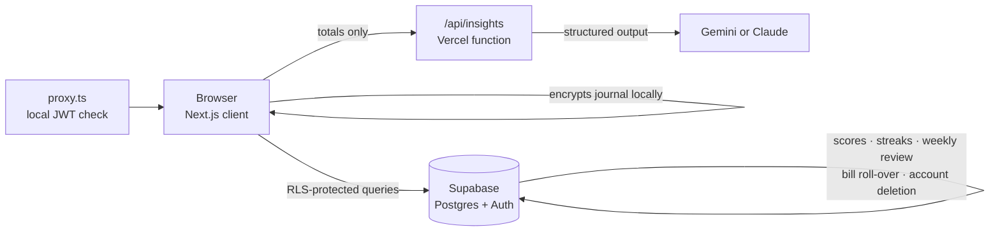

<div align="center">


<h1>dovie.</h1>

<p><strong>A softer place to start again.</strong><br/>
A gentle daily planner, habit tracker, budget app and private journal, in one calm space.</p>

<p>
  <a href="https://dovie-omega.vercel.app"><strong>Live app →</strong></a>
  &nbsp;·&nbsp;
  <a href="#-features">Features</a>
  &nbsp;·&nbsp;
  <a href="#-getting-started">Getting started</a>
  &nbsp;·&nbsp;
  <a href="#-seo--search-engines">SEO</a>
  &nbsp;·&nbsp;
  <a href="docs/deploy.md">Deploy guide</a>
</p>

<p>
  
  
  
  
  
  
  
</p>

</div>

---

## ✨ Why Dovie

Most productivity apps keep score. Dovie keeps you company.

It brings the everyday pieces of a life together: **plans, habits, movement, rest, money and a private journal**. Its tone notices progress instead of judging it. Unfinished plans roll gently into tomorrow, streaks bend around real life, and the weekly review is *a mirror, not a report card*.

<table>
<tr>
<td width="33%" valign="top">

**🌸 Gentle by design**<br/>
Warm copy, soft pastels and a "progress, not pressure" mindset in every screen.

</td>
<td width="33%" valign="top">

**🔒 Private by default**<br/>
Journal entries are encrypted in your browser. No bank logins, no ads, no selling data.

</td>
<td width="33%" valign="top">

**🔮 Quietly smart**<br/>
Forecasts your month's spending and predicts next week from your own numbers.

</td>
</tr>
</table>

---

## 🧭 Features

| Module | What it does |
|---|---|
| **☀️ Today** | Your top three priorities, the rest of the list, habits, a one-tap wellness check-in, bills due soon and an evening check-in with a daily score. Unfinished tasks carry over automatically. |
| **🗓️ Planner** | A month calendar with a checklist for every day: add tasks to any date, star up to three priorities, tick them off, and move unfinished ones forward. Days you clear get a check mark. |
| **🏃 Fitness** | A **live workout tracker** for 11 activities: moving time, GPS distance, pace, splits, route, step counter and cadence, calories, climb, laps and Bluetooth heart-rate straps. Workouts keep recording on every screen, survive a closed app and sync when you're back online. Plus activity rings, an all-day step counter, personal bests, history and a weight log. |
| **🎯 Goals** | Growth goals with progress, a habit tracker with streaks, daily fitness targets and a free-form movement log. |
| **💰 Money** | Expense tracker and budget planner in ₹: bills that roll forward when paid, monthly budgets by category, savings goals and a **month-end spending forecast**. The **AI savings coach** spots overspending, small repeat purchases and bills worth reviewing, then builds a personal saving plan with a 7-day challenge. Amounts are stored as integer paise. |
| **📖 Journal** | A private diary with a daily prompt, gratitude line and mood. **AES-256-GCM encrypted in the browser** with a passphrase and a one-time recovery key. |
| **💗 Wellness** | Sleep, water, energy and mood tracking, a kind focus timer and starter routines (Student, Gym beginner, 9-to-5). |
| **📅 Calendar** | A seven-day planner with time blocks; move tasks between days in one tap. |
| **📈 Weekly review** | Plans done, habit rhythm, rest and focus, rule-based observations and **next-week predictions** with weekday patterns. |
| **⚙️ Settings** | Name, timezone, focus areas, dark mode, local bill reminders, **JSON export**, clear all data, delete account. |

### 🔮 Predictions, explained

Dovie's predictions run **in the browser on your own entries**: free, instant and private.

- **Month-end spending:** this month's daily pace, blended with your 90-day average (early-month spikes are discounted), plus an ~80% likely range from your day-to-day variation.
- **Budgets and savings:** each category is projected against its limit (*on track · getting close · likely over*), and each savings goal gets an estimated finish date.
- **Next week:** a recency-weighted trend over four weeks for plans, habits, sleep, focus, movement and mood, plus your strongest weekday, the effect of sleep and a suggested daily plan load.

**Ask Dovie** (optional) turns those numbers into a short, warm read using Gemini or Claude, whichever key is configured. It sends **totals and labels only, never notes or journal text**, and runs behind sign-in, input validation and an hourly limit.

---

## 🛡️ Privacy & security

- **Row-level security** on every table: each account can only ever reach its own rows, enforced in Postgres.
- **A private journal**: pages are plain text on the account, readable only by their owner (row-level security) and never used for insights. There is no passphrase. The earlier end-to-end encrypted design is kept for reference in [`docs/crypto-spec.md`](docs/crypto-spec.md).
- **No bank, card or SMS access.** Money is entered by hand.
- **Your data, your call:** one-click JSON export, clear-everything and full account deletion (`delete_my_account()` cascades through every table).
- **Server-only secrets:** the Supabase service-role key is never used, and the Anthropic key never reaches the browser.

---

## 🏗️ Architecture



**Logic that must stay consistent across clients lives in Postgres**: daily score, habit streaks, carry-over, bill roll-over, the weekly review and account deletion. A future Flutter app can reuse it unchanged (see [`PLAN.md`](PLAN.md)).

<details>
<summary><strong>Performance notes</strong></summary>

- Sessions are verified locally with `getClaims()` (ES256 keys), with no auth round trip per navigation.
- Signed-in page shells are fully static; the profile is fetched once and shared.
- One client view per route, and charts are lazy-loaded so `recharts` stays out of page bundles.
- The query cache is persisted in the browser (wiped on any account change), screens prefetch on hover, and all data warms in the background when idle.

</details>

### Tech stack

| Layer | Choice |
|---|---|
| Framework | Next.js 16 (App Router, Turbopack, Cache Components) · React 19 · TypeScript |
| UI | Tailwind CSS 4 · shadcn/ui on Base UI · Lucide icons · Fraunces + DM Sans |
| Data | TanStack Query 5 (persisted cache) · Supabase JS + SSR |
| Backend | Supabase Postgres with RLS, SQL functions and triggers · Supabase Auth (email + Google) |
| Charts | Recharts (lazy-loaded) |
| AI | Google Gen AI SDK (Gemini) or Anthropic SDK (Claude), with structured JSON output (optional) |
| Hosting | Vercel |

---

## 🚀 Getting started

### Prerequisites

- Node.js 24+
- A free [Supabase](https://supabase.com) project

### 1. Install

```bash
git clone https://github.com/kirangautham-82899/Dovie.git
```

```bash
cd Dovie/apps/web
```

```bash
npm install
```

### 2. Configure

Copy `apps/web/.env.example` to `apps/web/.env` and fill it in:

| Variable | Required | Where to find it |
|---|---|---|
| `NEXT_PUBLIC_SUPABASE_URL` | ✅ | Supabase → Project Settings → API |
| `NEXT_PUBLIC_SUPABASE_ANON_KEY` | ✅ | Supabase → Project Settings → API Keys (publishable key) |
| `GEMINI_API_KEY` | optional | [aistudio.google.com](https://aistudio.google.com/apikey). Enables **Ask Dovie** with Gemini (used first when set). Server-only. |
| `ANTHROPIC_API_KEY` | optional | [console.anthropic.com](https://console.anthropic.com). Enables **Ask Dovie**. Server-only. |
| `NEXT_PUBLIC_SITE_URL` | optional | Your custom domain as a full URL (`https://…`), for canonical URLs and share cards |
| `GOOGLE_SITE_VERIFICATION` / `BING_SITE_VERIFICATION` | optional | Search engine meta-tag codes (see [SEO](#-seo--search-engines)) |

### 3. Set up the database

Run each file in [`supabase/migrations`](supabase/migrations) **in filename order** in the Supabase SQL Editor (or with the Supabase CLI on a fresh project).

### 4. Run

```bash
npm run dev
```

Open [http://localhost:3000](http://localhost:3000). For production speed locally, run `npm run build`, then `npm run start`.

---

## 🧪 Testing

```bash
npm run lint
```

| Script | What it checks | Needs Supabase? |
|---|---|---|
| `npm run test:crypto` | Journal encryption against the spec's test vectors, plus recovery-key round trips | No |
| `npm run test:forecast` | Month-end spending forecast maths | No |
| `npm run test:predict` | Next-week prediction maths | No |
| `npm run test:rls` | Two users can't see each other's data | Yes |
| `npm run test:tasks` / `test:habits` / `test:checkin` | Priorities, carry-over, streaks, daily score | Yes |
| `npm run test:life` | Money, journal storage, calendar, weekly review, clear data, delete account | Yes |

> Supabase-backed tests create throwaway `@example.com` users and need **Confirm email** switched off while they run.

CI runs lint and a production build on every push and pull request.

---

## ☁️ Deployment

Dovie runs on **Vercel**, with the root directory set to **`apps/web`**, and on **Supabase**. Every push to `main` deploys to production.

The full checklist (migrations, auth redirect URLs, Google sign-in and environment variables) is in **[`docs/deploy.md`](docs/deploy.md)**.

---

## 🔎 SEO & search engines

Dovie is registered with **Google Search Console** and **Bing Webmaster Tools**. Bing also feeds Edge, Yahoo, DuckDuckGo and Copilot.

### What's built in

| Piece | Where | Notes |
|---|---|---|
| Title, description, keywords, Open Graph, Twitter card | `src/app/layout.tsx`, `src/lib/site.ts` | Keyword-targeted copy (daily planner, habit tracker, expense tracker, budget planner, encrypted journal…) |
| Share image | `src/app/opengraph-image.tsx` | Generated at build time with `next/og` |
| Structured data | `src/app/page.tsx` | JSON-LD for the app (`SoftwareApplication`) and the FAQ |
| `robots.txt` | `src/app/robots.ts` | Allows public pages; blocks the signed-in screens, `/api/` and `/auth/` |
| `sitemap.xml` | `src/app/sitemap.ts` | Home, sign-up, sign-in, privacy, terms; regenerated on every deploy |
| Canonical URL | `src/lib/site.ts` | `NEXT_PUBLIC_SITE_URL` if set, otherwise Vercel's production URL |
| Favicons and app icons | `scripts/generate-favicons.mjs` (`npm run icons`), `src/lib/brand-icon.tsx` | |

### Ownership verification

| Engine | Method | File |
|---|---|---|
| Google Search Console | HTML file | `apps/web/public/googlef7f218449ee0b5a0.html` |
| Bing Webmaster Tools | XML file | `apps/web/public/BingSiteAuth.xml` |

> **Keep both files.** Google and Bing re-check them from time to time, and removing one drops the verification. `proxy.ts` lets them through without a sign-in, so crawlers can always reach them.

Meta-tag verification also works: set `GOOGLE_SITE_VERIFICATION` and/or `BING_SITE_VERIFICATION` in Vercel to the tag's `content` value, then redeploy.

### Adding a custom domain

1. Connect the domain in Vercel (**Settings → Domains**).
2. Set `NEXT_PUBLIC_SITE_URL` to the full URL (for example, `https://dovie.app`) and redeploy. Canonical URLs, the sitemap and share cards follow it.
3. In Search Console, add the domain as a new property and submit `sitemap.xml`. Then use **Settings → Change of address** to move from the old URL.
4. Add the domain in Bing Webmaster Tools too, or import it from Search Console.

---

## 📁 Project structure

```text
.
├── apps/web/                  Next.js app
│   ├── src/app/               Routes: landing, auth, (app) screens, API, SEO files
│   ├── src/components/        Shell, navigation, hero, charts, shared UI
│   ├── src/features/          One folder per feature: api.ts, hooks, components
│   │   ├── money/forecast.ts  Spending forecast
│   │   └── weekly/predict.ts  Next-week predictions
│   ├── src/lib/               Supabase clients, dates, money, AI helper, site config
│   └── scripts/               Test scripts (npm run test:*)
├── supabase/migrations/       Schema, RLS, SQL functions and triggers
├── docs/                      crypto-spec.md · deploy.md
└── PLAN.md                    Product and engineering roadmap
```

---

## 🗺️ Roadmap

- [x] Planner, habits, fitness, check-ins and daily score
- [x] Money: expenses, bills, budgets, savings goals and forecasts
- [x] Encrypted journal with recovery key
- [x] Wellness, calendar and weekly review with predictions
- [x] SEO: sitemap, structured data, Google and Bing verified
- [ ] Custom domain
- [ ] Email bill reminders (Resend + `pg_cron`)
- [ ] Installable offline PWA and web push
- [ ] Flutter mobile app on the same backend

See [`PLAN.md`](PLAN.md) for the full plan.

---

## 💌 Contributing

Ideas and bug reports are welcome. Please open an issue first to talk through bigger changes.

<div align="center">
<br/>
<sub>Made for real life, one little win at a time. 🕊️</sub>
<br/><br/>
<sub>Dovie is a planning and tracking tool, not medical or financial advice.</sub>
</div>
